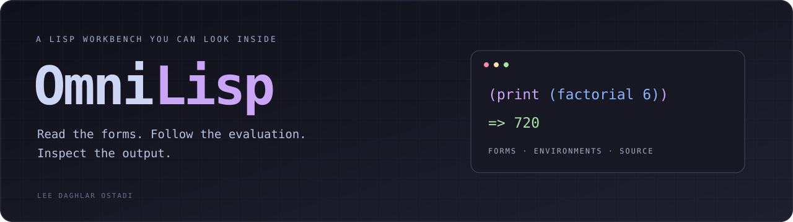

<p align="center">
  
</p>

<p align="center">
  <a href="#run-the-workbench">Workbench</a> ·
  <a href="#use-the-terminal">Terminal</a> ·
  <a href="#generate-source">Source generation</a> ·
  <a href="#what-is-implemented">Implementation</a>
</p>

**A Lisp workbench you can look inside.**

I want to see what a small language is doing: the forms it reads, the environment
in which they run, the calls they make, and the code a compiler produces from
them. OmniLisp puts those views next to the program.

The browser workbench includes an interpreter, a stepping debugger, an
environment inspector, a call graph, and source-generation panels. A smaller
standalone interpreter provides a terminal REPL and file execution. They share
a Lisp-shaped syntax, but they are separate implementations with different
supported subsets.

This is an experimental language workbench. Its TypeScript and Rust emitters,
dialect converters, and repair experiments are useful places to inspect and
extend the implementation; they are not complete language compatibility layers.

## Run the workbench

Use **Node.js 22.14 or newer** and npm. No model server or API key is required.

```sh
git clone https://github.com/lostadi/omnilisp.git
cd omnilisp
npm ci
npm run dev
```

Open **http://127.0.0.1:3000**. The development server binds to loopback.
Use the example selector, edit the program, and choose **Run** or **Step Debug**.
The AST, environment, call graph, and generated-source tabs expose different
parts of the same browser session.

The initial preset includes breakpoints, so **Build & Run** can pause at them.
Choose **Resume** to continue, or click the breakpoint markers in the editor
gutter to clear them. **Step Debug** gives you explicit stepping and **Stop**.

```sh
npm run lint       # TypeScript check
npm test           # Behavioral smoke tests
npm run build      # Static browser bundle in dist/
npm run preview    # Inspect the production bundle locally
```

The built-in interpreter and examples run locally. Explicit npm imports in the
browser can fetch code from ESM CDNs; some package names instead use small
built-in fallback implementations. Those fallbacks are not the full upstream
packages. Run code and import packages you trust: JavaScript interop executes
in the host page or Node process, without a security sandbox.

## Use the terminal

```sh
npm run cli -- eval -e '(print (+ 20 22))'
npm run cli -- run examples/factorial.lisp
npm run cli -- run examples/closures.lisp
npm run cli -- repl
```

The first command prints `42`. The examples print `720` and `42` respectively.
Enter `:exit` to leave the REPL.

```lisp
(def factorial
  (lambda (n)
    (if (<= n 1)
      1
      (* n (factorial (- n 1))))))

(print (factorial 6))
```

The CLI supports definitions, mutation, conditionals, closures, lists,
arithmetic, and basic host functions. `import-npm` loads packages already
resolvable by Node. The browser adds its own module registry, debugger, source
locations, and dialect conversion. Check the implementation before depending
on identical behavior between the two engines.

These commands run the local checkout. This publication does not establish an
`omnilisp` package on the npm registry. The manifest is marked `private` to
prevent accidental npm publication; the source repository is public.

## Generate source

The CLI loads the TypeScript implementation through `tsx`:

```sh
npm run cli -- build examples/factorial.lisp --target ts -o /tmp/factorial.ts
node --import tsx /tmp/factorial.ts

npm run cli -- build examples/factorial.lisp --target rust -o /tmp/factorial.rs
rustc --edition=2021 /tmp/factorial.rs -o /tmp/factorial
/tmp/factorial
```

Both generated examples were executed and printed `720`. Rust generation
produces source; compiling it requires `rustc`. Successful output for this
example does not establish that every accepted Lisp program translates
correctly. TypeScript-to-Lisp conversion is available in the browser UI and
the source API.

The WAT panel is a small arithmetic sketch emitter. It does not assemble or run
WebAssembly, and unsupported forms can produce placeholders.

## What is implemented

| Part | Source | Current role |
| --- | --- | --- |
| Reader and evaluator | [`src/lisp/parser.ts`](src/lisp/parser.ts), [`evaluator.ts`](src/lisp/evaluator.ts) | Browser/SDK expression evaluation with source locations and debugger hooks. |
| Environments and modules | [`envFactory.ts`](src/lisp/envFactory.ts), [`modules.ts`](src/lisp/modules.ts) | Bindings, host functions, standard modules, and custom module registration. |
| Source generation | [`tsTranspiler.ts`](src/lisp/tsTranspiler.ts), [`rustTranspiler.ts`](src/lisp/rustTranspiler.ts) | Partial TypeScript and Rust source emitters. |
| Dialect conversion | [`converter.ts`](src/lisp/converter.ts) | Heuristic Scheme, Clojure, and Common Lisp syntax conversion. |
| Browser UI | [`src/App.tsx`](src/App.tsx), [`src/components/`](src/components/) | Editor, stepping, environment views, graphs, and conversion panels. |
| Terminal | [`bin/omnilisp.js`](bin/omnilisp.js) | A separate compact interpreter, REPL, and source-generation front end. |

### Ostadix and repair experiments

The module named `ostadix` implements **local, in-process telemetry and message
queues**. It does not query a native Ostadix kernel, establish IPC with it, or
run the native `.O` toolchain. The CLI's `status` and `ping` commands disclose
this simulation boundary.

The legacy `fuzz` command applies heuristic rewrites: balancing delimiters,
introducing defaults, and, as a fallback, commenting out failing forms. It can
change the program's meaning or remove the work entirely. A candidate finishing
without an exception is not proof that the original task was repaired.

```sh
npm run cli -- fuzz broken.lisp -o candidate.lisp
```

Inspect the candidate before running it. The generated report wrapper records
repairs; it does not execute the original program. Browser repair trials use
the same page context as the interpreter, not an isolated sandbox.

## Verification

The publication checks cover TypeScript checking, the production web build,
CLI/browser-evaluator agreement on factorial and closures, ordinary failure
reporting, diagnostic labeling, and execution of generated TypeScript and Rust.
See [the verification record](docs/verification.md) for exact results and limits.

---

By **[Lee Daghlar Ostadi](https://leeostadi.com)**.
No software license has been specified for this snapshot.
